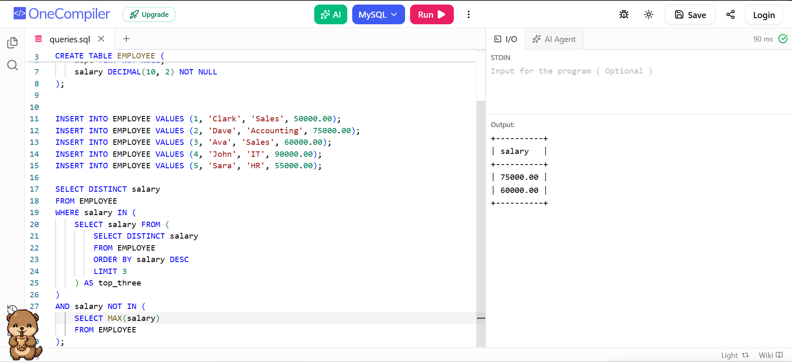

# Experiment 10 - Task 1

Name: ARUSHI GARG

UID: 24BCS11147

## Aim

To write and execute a SQL sub-query that finds the 2nd and 3rd highest
distinct salaries from the `employee` table.

## Question

Write a sub-query to find the 2nd and 3rd highest salary from the
`employee` table.

The query should:

1. Arrange the salaries in descending order.
2. Assign a rank to each distinct salary.
3. Display only the salaries having rank 2 and rank 3.
4. Return the result in descending order of salary.

## Concept Used

The query uses the `DENSE_RANK()` window function inside a sub-query.
`DENSE_RANK()` assigns the same rank to equal salaries and does not skip a
rank when duplicate salary values are present. The outer query filters the
ranked result and selects only ranks 2 and 3.

Using distinct salary values ensures that the result represents the
2nd and 3rd highest salary amounts rather than the 2nd and 3rd employee
rows.

## Sample Employee Data

The query can be tested with the following sample records:

| employee_id | employee_name | salary |
|-------------|---------------|--------|
| 101         | Amit          | 90000  |
| 102         | Rahul         | 80000  |
| 103         | Priya         | 70000  |
| 104         | Neha          | 60000  |
| 105         | Karan         | 80000  |
| 106         | Simran        | 50000  |

The distinct salaries in descending order are:

1. 90000
2. 80000
3. 70000
4. 60000
5. 50000

Therefore, the expected answer is `80000` and `70000`.

## SQL Queries Used

### Create the Employee Table

```sql
CREATE TABLE employee (
    employee_id INT PRIMARY KEY,
    employee_name VARCHAR(100),
    salary NUMERIC(10, 2)
);
```

### Insert Sample Records

```sql
INSERT INTO employee (employee_id, employee_name, salary) VALUES
(101, 'Amit', 90000),
(102, 'Rahul', 80000),
(103, 'Priya', 70000),
(104, 'Neha', 60000),
(105, 'Karan', 80000),
(106, 'Simran', 50000);
```

### Sub-Query to Find the 2nd and 3rd Highest Salaries

```sql
SELECT salary
FROM (
    SELECT DISTINCT salary,
           DENSE_RANK() OVER (ORDER BY salary DESC) AS salary_rank
    FROM employee
) AS ranked_salaries
WHERE salary_rank IN (2, 3)
ORDER BY salary DESC;
```

### Explanation of the Query

The inner query selects every distinct salary from the `employee` table and
assigns a rank in descending order:

```sql
SELECT DISTINCT salary,
       DENSE_RANK() OVER (ORDER BY salary DESC) AS salary_rank
FROM employee;
```

The outer query filters the result using `salary_rank IN (2, 3)`. This
returns only the 2nd and 3rd highest distinct salary values. The final
`ORDER BY salary DESC` displays the 2nd highest salary before the 3rd
highest salary.

## Output

```text
 salary
--------
  80000
  70000
(2 rows)
```

The intermediate ranked result is:

| salary | salary_rank |
|--------|-------------|
| 90000  | 1           |
| 80000  | 2           |
| 70000  | 3           |
| 60000  | 4           |
| 50000  | 5           |

## Output Screenshot



## Image Explanation

The screenshot shows the execution of the SQL query on the `employee`
table. The sub-query ranks the distinct salary values from highest to
lowest. The outer query selects rows with ranks 2 and 3, so the output
contains `80000` as the 2nd highest salary and `70000` as the 3rd highest
salary.

The duplicate salary of `80000` is treated as one salary amount because
`DENSE_RANK()` assigns the same rank to equal values. This confirms that
the query finds the 2nd and 3rd highest distinct salaries correctly.

## Result

The SQL sub-query was successfully written to find the 2nd and 3rd
highest distinct salaries from the `employee` table. For the sample data,
the query returned `80000` and `70000` in descending order.
